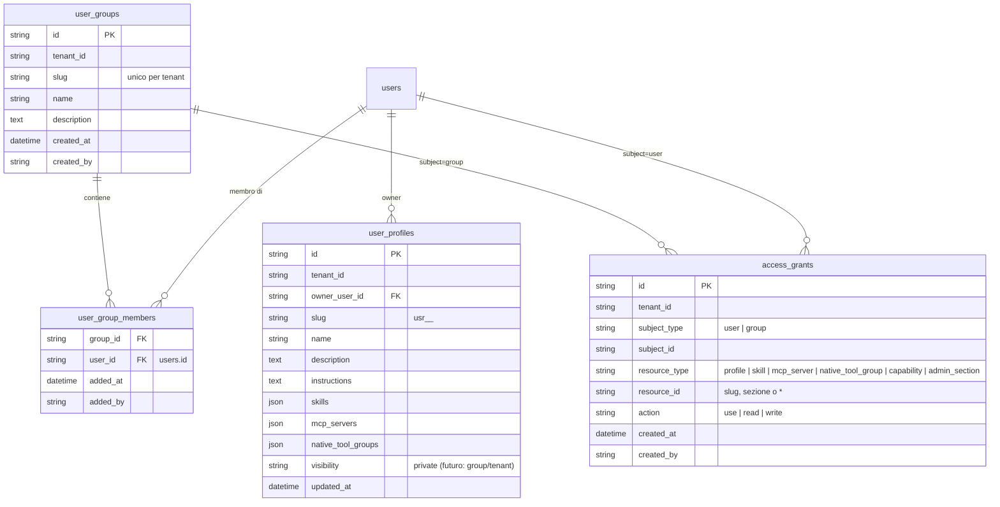
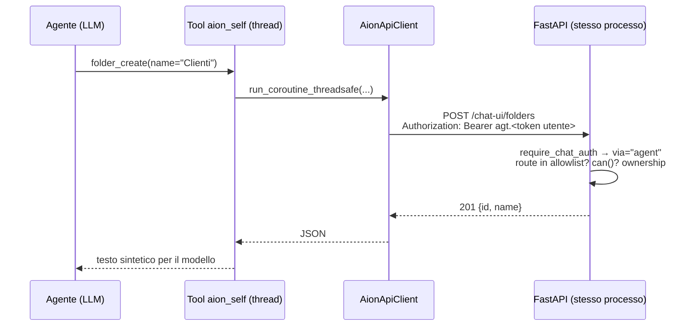
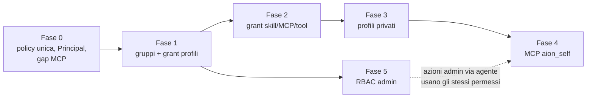

# Piano: gruppi, permessi, profili privati, MCP di self‑management, RBAC admin

Stato: **proposta** (2026‑11‑23). Si implementa una fase alla volta; ogni fase
lascia il sistema funzionante e retro‑compatibile, e prepara i ganci per la
successiva.

---

## 1. Stato attuale (sintesi dell'analisi del codice)

| Area | Oggi | Riferimenti |
|---|---|---|
| Ruoli | `users.roles` JSON libero; l'unico ruolo controllato è `admin`. Ruoli **congelati nel token** al login | `src/api/auth_login.py` (`issue_chat_token`, `require_admin_role` L851), `src/data/user_password.py` |
| Accesso profili | Allowlist per utente in `user_profile_access`; lista vuota = tutti; fallback `aion_std` → `allowed[0]`. Admin limitati come tutti | `src/api/profile_access.py`; logica **duplicata** in `src/main.py:1207-1225` e `get_allowed_profiles_for_user` (`src/main.py:624`) |
| Enforcement profili | chat v1, conversations, legacy `/chat`, a2a, cron (API + tool), telegram, whatsapp, agent factory | vedi `grep enforce_profile_access` |
| Profili | Solo YAML (`config/profiles` + overlay `AION_PROFILES_WRITE_DIR`), nessun owner/visibilità; CRUD solo `/admin/profiles` | `src/agent_profile.py`, `src/runtime/profile_schema.py` |
| Skills | Solo filesystem (`config_std/skills`, `config/skills`, `data/skills/generated`), singleton globale; `skill_view` limitato alle skill del profilo | `src/skill_registry.py`, `src/runtime/skill_profile_gate.py` |
| MCP | Registry YAML + `mcp_server_configs` (globale, flag `is_enabled_for_users`), preferenze e credenziali per utente | `src/mcp_manager.py`, `src/api/v1/mcp_integrations.py` |
| Gap MCP | Il filtro preferenze utente vale solo per i server *residenti*; il path *deferred* (`_mcp_group_tools`) non controlla `skip_slugs`/`is_enabled_for_users`; preferenze non nella cache key | `src/main.py:1070-1101`, `src/runtime/tool_exposure.py:738-765` |
| Agent cache | Chiave = session, profile slug, `profile_sig` (mcp+skills+gruppi nativi+hash registry), user, tenant, … | `src/main.py:1290-1294` |
| Admin UI | Gate binario `roles.includes("admin")`; nav in `admin-ui/lib/admin-nav.ts` con `id` stabili per sezione; nessun gating per sezione | `admin-ui/components/auth/AdminAuthGate.tsx` |
| Chat UI | Nessun contesto utente/ruoli centrale (`/auth/me` letto in `ThreadSidebar`); nessuna creazione profili | `chat-ui/components/layout/ThreadSidebar.tsx` |
| Audit | `record_admin_action` esiste ma non copre CRUD profili/skill/MCP né modifiche ruoli/accessi | `src/data/audit.py` |
| Tenant | Colonna `tenant_id` diffusa, risolta da env `AION_DEFAULT_TENANT_ID` | — |
| Tool “agente su sé stesso” già esistenti | `cron_tools` in‑process (CRUD job con check profilo e limite per utente) | `src/runtime/cron_tools.py` |
| Migrazioni | Alembic, head attuale `i7f8l9d037` | `migrations/versions/` |

**Problemi strutturali da risolvere prima di tutto:** logica di accesso
duplicata in 3 punti, `user_id` incoerente (identifier vs row id) tra le tabelle,
ruoli congelati nel token, gap di filtro sul path MCP deferred.

---

## 2. Principi di design (validi per tutte le fasi)

1. **Un solo punto di decisione**: un modulo `src/access/` con un oggetto
   `Principal` (utente + gruppi + permessi effettivi) e funzioni
   `can(principal, action, resource_type, resource_id)` /
   `allowed(principal, resource_type, action)`. Nessun endpoint, tool o canale
   interroga direttamente le tabelle di accesso.
2. **Solo allow, unione**: i permessi effettivi = unione dei grant diretti
   dell'utente e dei grant dei suoi gruppi. Niente regole *deny* nella v1
   (semplici da ragionare, nessun conflitto di precedenza). Il modello dati
   lascia spazio a un campo `effect` futuro.
3. **“Nessuna regola = nessun limite”, per tipo di risorsa** (decisione D0,
   rivista il 2026‑11‑23: niente gruppo `default`). Per ogni tipo (`profile`,
   `skill`, …) un soggetto (l'utente o uno dei suoi gruppi) può **avere una
   regola** (lista di id, `*` = tutti, lista vuota = nessuno) oppure **non
   averla**. Se nessun soggetto dell'utente ha una regola per quel tipo,
   l'utente non ha limiti su quel tipo (come oggi). Altrimenti può usare
   l'unione delle liste dei soggetti che hanno una regola; quelli senza regola
   non contano. Esempio: gruppo A “profili X, Y” + gruppo B senza regola sui
   profili → X, Y. Nessun utente nascosto in un gruppo di sistema, nessuna
   auto‑iscrizione.
4. **Permessi letti dal DB, non dal token**: il token resta identità; i permessi
   si risolvono per richiesta con cache in‑process breve (TTL ~30s) invalidata
   esplicitamente a ogni modifica di grant/gruppi/ruoli. Così revoche e nuovi
   permessi valgono subito, senza re‑login.
5. **Le API REST sono l'unica porta d'ingresso**: validazione, ownership e
   permessi stanno negli endpoint (che usano `can()`). Admin UI, chat-ui e MCP
   di self‑management (Fase 4) passano tutti dalle stesse API → nessuna logica
   duplicata e nessun bypass possibile via agente.
6. **Tutto per tenant**, FK a `users.id` (row id) sulle nuove tabelle, audit su
   ogni modifica di permessi.
7. **Invalidazione agent cache**: ogni modifica che cambia ciò che un utente può
   usare invalida le entry di `_AGENT_CACHE` di quell'utente (o di tutti i membri
   del gruppo).

---

## 3. Modello dati target

Unico vincolo: `UNIQUE(tenant_id, subject_type, subject_id, resource_type, resource_id, action)`.

Una regola “nessuno” (lista vuota) si salva come una riga con
`resource_id = "!none"`: così “ha una regola che non concede niente” resta
distinguibile da “non ha una regola”.

### Catalogo dei permessi (`resource_type` × `action`)

| resource_type | resource_id | action | Significato | Fase |
|---|---|---|---|---|
| `profile` | slug o `*` | `use` | può chattare/schedulare con il profilo | 1 |
| `skill` | nome o `*` | `use` | può usare la skill nei **propri** profili | 2 |
| `mcp_server` | slug o `*` | `use` | può usare l'MCP nei propri profili / attivarlo in Integrazioni | 2 |
| `native_tool_group` | nome o `*` | `use` | idem per i gruppi di tool nativi (web_research, …) | 2 |
| `capability` | es. `private_profiles.create`, `self_mgmt.use`, `cron.create`, `api_keys.create` | `use` | azioni utente finale | 3‑4 (estendibile) |
| `admin_section` | id di `ADMIN_NAV` (`profiles`, `skills`, `hub`, `users`, `settings.smtp`, …) o `*` | `read` / `write` | accesso al pannello admin | 5 |

Il ruolo `admin` in `users.roles` resta come **super‑admin** per il pannello:
ha sempre tutti i permessi `admin_section` (non revocabili tramite grant), così
non si perde mai l'accesso. **Per l'uso** (profili, skill, MCP, capability)
l'admin segue invece le stesse regole degli altri utenti, come oggi: senza
regole non ha limiti, ma se l'admin si imposta delle restrizioni (o entra in un
gruppo che le ha) queste valgono anche per lui (decisione D1).

---

## 4. Fasi

### Fase 0 — Fondamenta (nessuna feature visibile) — ✅ implementata

Obiettivo: un unico punto di decisione e i gap chiusi, senza cambiare
comportamento.

- `src/access/principal.py`: `Principal` (user row id, identifier, tenant,
  account_type, `is_superadmin`, gruppi, grant effettivi) + `load_principal()`
  con cache TTL e `invalidate_principal(user_id | group_id)`.
- `src/access/policy.py`: `can()`, `allowed_set()`, `effective_profiles()`.
  In Fase 0 è un adapter sopra `user_profile_access` (stessa semantica di oggi).
- Rifattorizzare i 3 duplicati (`profile_access.py`, `src/main.py:624`,
  `src/main.py:1207`) e tutti i call site (chat, cron, canali, a2a) per passare
  dal modulo unico.
- `require_permission(resource_type, action, resource_id=None)` FastAPI
  dependency; `require_admin_role` diventa `require_permission("admin_section", "*")`
  implementato come “è super‑admin” (identico a oggi).
- Ruoli letti dal DB in `require_chat_auth` (il token resta identità) →
  prerequisito per permessi che cambiano senza re‑login.
- Chiudere il gap MCP: filtro coerente su path residente **e** deferred
  (`_mcp_group_tools`), includere preferenze/permessi nel `profile_sig` della
  cache key. ⚠️ verificare con test che non cambi il comportamento dei profili
  admin (regola “il profilo vince”, vedi Fase 2).
- Normalizzare `user_id` nelle nuove API (sempre row id) con helper unico.
- `GET /auth/me` restituisce già `permissions` (in Fase 0: `["*"]` per admin,
  vuoto per gli altri) e `groups` → i frontend si preparano.
- chat-ui: `CurrentUserProvider` (contesto con `/auth/me`) al posto della fetch
  locale in `ThreadSidebar`; admin-ui: idem nel gate.
- Audit su modifiche ruoli/accessi profilo già esistenti.
- **Test**: matrice di regressione su `enforce_profile_access` (utente senza
  righe, con righe, fallback `aion_std`, service account, API key).

### Fase 1 — Gruppi utenti + migrazione accessi profilo — ✅ implementata

- Migrazione Alembic: `user_groups`, `user_group_members`, `access_grants`.
- **Nessun gruppo di sistema**: un utente nuovo non è in nessun gruppo e non ha
  regole, quindi non ha limiti (principio 3). Non serve toccare i punti di
  creazione utente.
- **Migrazione dati**: ogni riga di `user_profile_access` diventa una regola
  diretta dell'utente `profile:<slug>:use`. Nient'altro: chi oggi non ha righe
  resta senza regole. Fino al drop della tabella legacy, il `Principal` legge
  anche `user_profile_access` (come regole dirette), così anche un DB su cui la
  migrazione dati non è girata (`alembic stamp head` su DB legacy) resta
  corretto. Le scritture vanno solo su `access_grants` e puliscono le righe
  legacy dell'utente.
- **Come si restringe un utente**: lo si mette in un gruppo con una regola (es.
  “Commerciali” con i profili X e Y) o gli si dà una regola diretta.
- Policy: per tipo di risorsa, unione delle liste dei soggetti che hanno una
  regola; il fallback `aion_std → primo consentito` resta (ordine: regole
  dirette, poi gruppi). Nessun bypass per gli admin sull'uso (D1).
- API admin: `GET/POST/PATCH/DELETE /admin/groups`, `PUT /admin/groups/{id}/members`,
  `GET/PUT /admin/groups/{id}/grants`, `GET/PUT /admin/users/{id}/grants`
  (sostituisce `/admin/users/{id}/profiles`, che resta come shim compatibile),
  `GET /admin/users/{id}/effective-access` (mostra *da dove* arriva ogni permesso).
- Admin UI: tab **Gruppi** nella pagina Utenti, accanto ad Account e Accesso
  (lista, membri, regole); nella pagina
  Utenti colonna gruppi + dialog “Accessi” con vista effettiva (diretti vs
  ereditati). `ProfilesDialog` generalizzato in `GrantsDialog` riusabile per le
  fasi 2 e 5.
- Service account: possono stare nei gruppi (stessa logica).
- Invalidazione `Principal` + agent cache su modifica gruppi/membri/grant.
- Docs: `docs/security/groups-and-permissions.md`.

### Fase 2 — Permessi su skill, MCP e gruppi di tool nativi

**Regola di prodotto:** i permessi su skill/MCP **non** filtrano i profili
creati dall'admin. Se un utente può usare il profilo X, X funziona per intero
anche se contiene skill/MCP che l'utente non ha a livello individuale.
I permessi skill/MCP governano solo ciò che l'utente può **comporre o
attivare da sé**.

- Policy: `allowed_skills(principal)`, `allowed_mcp_servers(principal)`,
  `allowed_native_tool_groups(principal)` (wildcard + glob coerenti con
  `AgentProfile.resolved_skills`).
- Dove si applicano:
  - Integrazioni (chat‑ui `/integrations`, `/v1/integrations`): l'utente vede e
    configura gli MCP consentiti **più** quelli richiesti dai profili che può
    usare (altrimenti non potrebbe inserire le credenziali di un MCP di un
    profilo assegnato).
  - Editor dei profili privati (Fase 3) e tool di self‑management (Fase 4).
  - Picker in chat‑ui di skill/MCP (Fase 3).
- `skill_profile_gate` resta com'è (limita al profilo attivo).
- Admin UI: tab **Skill**, **MCP**, **Tool nativi** nel `GrantsDialog` di utenti
  e gruppi; nella pagina Skill/Hub badge “usata da N gruppi”.
- `GET /auth/me` / `GET /v1/me/access` restituisce i set consentiti al client.
- Test: profilo admin con skill non consentita → funziona; profilo privato con
  skill revocata → skill rimossa a runtime (vedi Fase 3).

### Fase 3 — Profili privati per l'utente finale

- Storage: tabella **`user_profiles` nel DB** (non YAML): ownership, tenant,
  nessuna collisione di file, funziona con più container e backup DB.
- Slug namespaced `usr_<shortid>_<nome>` (rispetta `[a-z0-9_]+`), mai in
  conflitto con gli slug globali.
- `ProfileManager.resolve_profile(slug, principal)` diventa composito:
  profili file (globali) + profili DB dell'owner. Il resto della pipeline
  (`AgentProfile`, `generate_system_prompt`, cache key via `profile_sig`) non
  cambia perché lavora già su un oggetto `AgentProfile`.
- **Validazione doppia**:
  - al salvataggio: `skills ⊆ allowed_skills`, `mcp_servers ⊆ allowed_mcp`,
    `native_tool_groups ⊆ allowed_native`, limiti (n° profili per utente,
    lunghezza istruzioni, n° skill), slug valido;
  - a runtime: intersezione con i permessi **attuali** (se l'admin revoca una
    skill, il profilo privato la perde subito; differenza voluta rispetto ai
    profili admin). `critical_skills` fissate dal sistema, non modificabili.
- Accesso: un profilo privato è usabile solo dall'owner (+ super‑admin in
  lettura per supporto). `effective_profiles` = grant `profile` ∪ profili propri.
  Funziona automaticamente in chat, cron, Telegram/WhatsApp perché passano dalla
  policy unica (Fase 0).
- Capability `private_profiles.create` (grant `capability`) per abilitare la
  funzione per utente/gruppo; attiva per tutti finché non esiste una regola
  `capability` che la escluda (D2).
- API: `GET/POST/PATCH/DELETE /v1/me/profiles`, `POST /v1/me/profiles/{slug}/duplicate`
  (partire da un profilo consentito: copia solo skill/MCP consentiti),
  `GET /v1/me/profile-building-blocks` (skill/MCP/tool consentiti con descrizioni).
- chat-ui: Impostazioni → **I miei profili** (lista + editor: nome, descrizione,
  istruzioni, picker skill/MCP/tool nativi); nel selettore profilo sezione
  “Personali”. Riutilizzare `ProfileOptionGrid`.
- Admin UI: in Profili un filtro “Profili utente” (sola lettura, per supporto).
- Cancellazione di un profilo privato usato da cron/conversazioni: i job vanno
  in pausa con errore leggibile; le conversazioni tornano al profilo di default.
- Futuro già previsto dal modello: `visibility = group|tenant` per condividere.

### Fase 4 — MCP di self‑management (“aion_self”)

L'agente esegue azioni sulla piattaforma per conto dell'utente in chat.
**Approccio: wrapper sottili sopra le API REST esistenti**, nessuna logica di
business nei tool.

#### 4.1 Verifica dell'esistente (fatta il 2026‑11‑23)

| Azione | API esistente | Note |
|---|---|---|
| Cron job | `/v1/cron-jobs` (`src/api/cron_user.py`): list, get, create, patch, delete, run-now, runs | Completa |
| Cartelle chat | `/chat-ui/folders` GET/POST/PATCH/DELETE + `PUT /chat-ui/conversations/{id}/folder` (`src/api/chat_folders.py`) | Completa |
| Conversazioni | `/v1/conversations` list/get/patch (rinomina)/delete | Completa |
| Progetti memoria (SQL) | `/v1/query-memory/projects` GET/POST/PATCH + members GET/POST/DELETE (`src/api/v1/query_memory.py`) | Manca il delete progetto lato utente |
| Note memoria progetto / utente | `/v1/project-memory/notes*`, `/v1/user-memory/notes*` | Complete |
| Profili globali | `/admin/profiles` GET, POST (upsert), DELETE | Solo admin; nessun PATCH (POST sovrascrive tutto il profilo) |
| Skill | `/admin/skills` GET, POST, DELETE, rename | Solo admin; nessuna API utente |
| Profili privati | — | Arrivano con la Fase 3 (`/v1/me/profiles`) |
| Permessi dell'utente | — | Arriva con la Fase 0 (`/auth/me` con `permissions`) |
| Conferma azioni distruttive | — | La tabella `approval_rules` esiste nel modello ma **nessun codice la usa**: il meccanismo va creato |

Cosa c'è già lato tool, e perché va rifatto:

- I tool cron (`src/runtime/cron_tools.py`) **non** chiamano le API: duplicano
  la logica scrivendo direttamente con `cron_db`, e sono già divergenti
  dall'endpoint (`create_my_cron_job`): mancano `sql_query_project`,
  `agent_mode`, `enabled` e il controllo `_require_owned_session`. È
  esattamente il problema che il wrapper evita. In questa fase vengono
  riscritti come wrapper sulle API `/v1/cron-jobs`, mantenendo gli stessi nomi
  di tool per non rompere i prompt esistenti.
- Il meccanismo utile da riusare è il loro modo di eseguire codice async: i tool
  Haystack girano in un thread e schedulano la coroutine sul loop principale
  con `asyncio.run_coroutine_threadsafe(coro, _GLOBAL_LOOP)`.

#### 4.2 Architettura del wrapper

- **Trasporto**: `httpx.AsyncClient` con `ASGITransport(app)`, eseguito sul loop
  principale. La richiesta attraversa middleware, dependency e validazione
  esattamente come una chiamata dalla chat-ui, ma senza rete: niente porte, TLS,
  Caddy o URL da configurare, funziona uguale in locale e in Docker.
- **Identità: token “agent”** emesso per turno di chat dalla pipeline
  (`issue_agent_token(user)`, HMAC come il chat token, prefisso `agt.`, TTL
  breve, legato alla sessione). `require_chat_auth` lo riconosce e crea
  `ChatAuthIdentity(via="agent", …)` con l'utente reale e i ruoli letti dal DB
  (Fase 0). Mai `X-AION-User-Id` o variabili d'ambiente.
- **Allowlist delle route**: un token `agt.` è valido **solo** sulle route
  elencate nel catalogo dei tool. Così l'agente non può mai cambiare password,
  creare API key, toccare SSO/2FA o altro, anche se l'utente è admin.
- **Catalogo dichiarativo** (`src/runtime/self_mgmt/catalog.py`): per ogni tool
  nome, descrizione per il modello, metodo + path template, schema dei parametri
  (riusando i modelli Pydantic dell'endpoint), flag `destructive`, permesso
  necessario per mostrarlo. Un generatore crea i tool Haystack. Aggiungere un
  tool = aggiungere una riga.
- **Visibilità**: gruppo deferred `aion_self` (attivabile con
  `activate_tool_group`), registrato `type: in_process` come `cron`. Mostra solo
  i tool che l'utente può effettivamente usare (`can()` sul `Principal`), più
  `whoami_permissions` per far sapere al modello cosa può fare.
- **Errori**: 403/404/422 dell'API tradotti in messaggi brevi per il modello
  (“non hai il permesso di …”), mai stack trace.
- **Audit**: le API che scrivono registrano `via=agent` (da `ChatAuthIdentity.via`).

#### 4.3 Tool previsti

- **Profili**: `profile_list`, `profile_get`, `profile_create`,
  `profile_update`, `profile_delete`. Utente: wrapper su `/v1/me/profiles`
  (Fase 3, solo i propri). Admin o chi ha `admin_section:profiles:write`:
  anche `/admin/profiles`. `profile_update` legge il profilo, applica le
  modifiche e fa POST (l'API admin è un upsert completo); in alternativa si
  aggiunge un `PATCH /admin/profiles/{name}`.
- **Skill**: `skill_list`, `skill_get`; scrittura solo con
  `admin_section:skills:write` via `/admin/skills`. I tool di scrittura di
  `skills_hub` (`skill_save`, oggi spenti con `AION_SKILL_WRITE_ENABLED=0`) non
  vengono usati, per non avere due strade.
- **Cron**: gli 8 tool attuali riscritti sopra `/v1/cron-jobs`.
- **Cartelle e conversazioni**: `folder_list/create/rename/delete`,
  `conversation_move_to_folder`, `conversation_rename`.
- **Progetti memoria**: `memory_project_list/create/update`,
  `memory_project_member_add/remove`, note di progetto. Da aggiungere
  l'endpoint di delete progetto lato utente se lo vogliamo esporre.

#### 4.4 Conferma delle azioni distruttive

Non esiste un meccanismo riusabile, quindi lo creiamo. Proposta v1, a due
passi e senza modifiche alla UI:

1. il tool con `destructive=true` non esegue: restituisce un riepilogo
   (“Eliminerò la cartella Clienti con 12 chat”) e un `confirm_token` monouso,
   legato a utente, sessione, tool e argomenti, con scadenza breve;
2. il modello chiede conferma all'utente in chat;
3. solo un secondo turno utente seguito da `confirm_action(confirm_token)`
   esegue la chiamata API.

Il controllo “c'è stato un nuovo messaggio utente dopo l'emissione del token”
lo fa il backend, non il modello. In futuro si può sostituire con un pulsante
di approvazione nella chat‑ui tramite evento SSE, senza cambiare i tool.

#### 4.5 Altro

- Capability `self_mgmt.use` per abilitare il gruppo di tool (attiva per tutti
  finché non esiste una regola `capability` che la escluda).
- Rate limit per utente sulle chiamate di scrittura con token `agt.`.
- Se l'agente modifica il profilo **in uso**, la modifica vale dal turno
  successivo (nuova `profile_sig` nella cache key).
- Test: per ogni tool, una chiamata riuscita e una negata (utente senza
  permesso, risorsa di un altro utente); test che un token `agt.` venga
  rifiutato su una route fuori allowlist.

### Fase 5 — RBAC granulare sul pannello admin

- Permessi `admin_section:<id>:read|write`, assegnabili a utenti e **gruppi**
  (i gruppi fanno da “ruoli”: es. gruppo “Gestori profili” con
  `profiles:write`, `skills:read`). Nessuna entità “ruolo” separata.
- Catalogo sezioni = `id` di `admin-ui/lib/admin-nav.ts` + sotto‑sezioni di
  Settings (`settings.smtp`, `settings.sso`, `settings.smb`, `settings.llm`…).
  Catalogo definito **una volta** nel backend (`src/access/catalog.py`) ed
  esposto via `GET /admin/permissions/catalog` (label i18n lato UI).
- **Sezioni riservate al super‑admin** (non delegabili nella v1): gestione
  gruppi/permessi, utenti admin, SSO/login mode, 2FA policy, aggiornamenti,
  service account. Evita escalation di privilegi.
- Regole anti‑escalation: chi ha `users:write` non può assegnare permessi che non
  possiede, né modificare/disabilitare super‑admin.
- Backend: sostituire la dependency router‑level `require_admin_role` con una
  **mappa endpoint → (sezione, azione)** (GET = read, altri metodi = write, con
  override espliciti). `admin.py` (~4400 righe, molte sezioni) richiede una
  tabella di mapping per prefisso di path; test automatico che **ogni** route
  `/admin/*` sia mappata (fallisce se se ne aggiunge una senza mapping → default
  super‑admin).
- Login `client=admin`: consentito se l'utente ha almeno un permesso
  `admin_section`.
- Admin UI: `AdminAuthGate` usa `permissions`; `ADMIN_NAV` filtrata; ogni pagina
  in modalità sola lettura se manca `write` (hook `useCan(section, action)`).
- Granularità per risorsa (es. “può modificare solo il profilo X”): lo schema la
  supporta già (`resource_id`), ma **non** si implementa nella v1.

---

## 5. Dipendenze tra fasi

La Fase 4 può partire prima della 5: le azioni “admin” dell'agente controllano
`can(admin_section:…)`, che fino alla Fase 5 equivale a “è super‑admin”.
Quando arriva la Fase 5 l'agente eredita automaticamente i permessi granulari.

---

## 6. Decisioni aperte (con proposta)

| # | Decisione | Esito |
|---|---|---|
| D1 | Il super‑admin bypassa le restrizioni sui profili? | ✅ **Deciso: no, come oggi.** Senza regole l'admin non ha limiti, ma se se li imposta valgono anche per lui. Il bypass vale solo per il pannello admin |
| D2 | Profili privati abilitati di default a tutti? | ✅ **Deciso: sì**, nessuna regola `capability` = consentito a tutti |
| D0 | Gruppo `default` | ✅ **Deciso (rivisto)**: nessun gruppo di sistema. “Nessuna regola = nessun limite”, valutato per tipo di risorsa (principio 3) |
| D3 | Limiti profili privati | 10 profili/utente, istruzioni ≤ 20k caratteri (configurabili via env) |
| D4 | Profili privati condivisibili con gruppo/tenant | Fuori scope v1, schema già pronto |
| D5 | Regole *deny* | Fuori scope v1 |
| D6 | Skill private create dall'utente | Fuori scope v1 (eventuale fase 6, stesso modello) |
| D7 | Conferma azioni distruttive dell'agente | Obbligatoria per delete e per modifiche a risorse globali, a due passi con `confirm_token` (§4.4) |
| D9 | Tool cron esistenti | Riscritti come wrapper su `/v1/cron-jobs`, stessi nomi |
| D8 | Granularità RBAC admin | Sezione × read/write; per‑risorsa in futuro |

---

## 7. Rischi e mitigazioni

- **Regressioni di accesso** (utenti che perdono o guadagnano profili): matrice di
  test sulla migrazione dati + endpoint `effective-access` per verificare a mano
  prima/dopo.
- **Token vecchi con ruoli congelati**: dalla Fase 0 i ruoli si leggono dal DB.
- **Cache agente stantia dopo una revoca**: invalidazione esplicita + permessi
  nella cache key.
- **Escalation via agente** (Fase 4): i tool chiamano le API REST con un token
  `agt.` valido solo su un'allowlist di route; i controlli restano negli
  endpoint; conferma esplicita lato backend; audit `via=agent`.
- **Route admin dimenticate** (Fase 5): test che fallisce su route non mappate,
  default super‑admin.
- **Performance**: `Principal` cacheato per utente, query per gruppi con indici
  su `(tenant_id, subject_type, subject_id)` e `(group_id)`, `(user_id)`.
