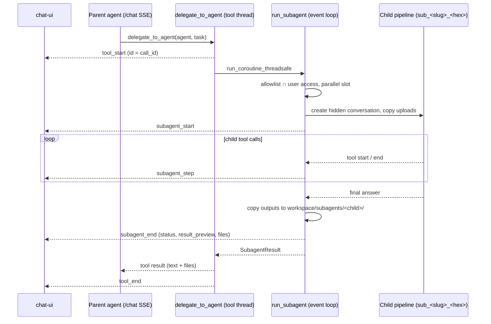

# Sub-agents

A **sub-agent** is another agent profile that the main chat agent can call, at
its own discretion, to carry out a self-contained task. The idea mirrors the
sub-agents of Claude Code: the parent hands over a complete brief, the child
works in its own isolated context with its own instructions, skills and tools,
and only the final answer comes back to the parent.

**Why:** a specialised profile (e.g. a "legal reviewer" or an "SQL analyst")
often needs instructions and tools that would bloat or confuse the general
assistant. Delegating keeps the parent context small, lets each profile keep
its own prompt and tool set, and allows independent tasks to run in parallel.

## Configuration

### Profile allowlist (`subagents`)

Delegation is opt-in per parent profile. The profile YAML lists the slugs of
the profiles it may call:

```yaml
# config/profiles/aion_std.yaml
name: AION Standard
subagents:
  - legal_reviewer
  - sql_analyst
```

The same list is edited from **admin-ui → Profiles → Sub-agents** (its own tab in the profile editor): the
picker shows every other profile with its `description`, which is exactly the
text the parent LLM reads in the tool catalog. Write descriptions that say
*what the profile is good at*: they drive the choice of whom to delegate to.

Rules enforced by the backend:

| Rule | Where | Why |
|------|-------|-----|
| The profile's own slug is dropped | `normalize_subagent_slugs` (`src/runtime/profile_schema.py`) | Self-delegation would just recurse. |
| Unknown slugs are refused on save (HTTP 400) | `POST /admin/profiles` (`src/api/admin.py`) | A stale UI or a typo must not silently produce a dead entry. |
| The runtime list is `subagents ∩ profiles the user may use` | `allowed_subagent_slugs` (`src/runtime/subagent_orchestrator.py`) | Delegation must never become a way to reach a profile the user has no access to. |
| An empty list means no tool | `build_delegate_to_agent_tool` (`src/runtime/native_tools/factory_table.py`) | Profiles without sub-agents pay no prompt cost. |
| A non-empty list attaches the `delegation` skill, inlined in full | `AgentProfile.resolved_skills` (`src/agent_profile.py`) | The parent must know when and how to delegate; admins only pick sub-agents. |

### The `delegation` skill is automatic

The `delegation` skill (`config_std/skills/delegation.md`) is a **system skill**
(`SYSTEM_SKILLS` in `src/runtime/profile_schema.py`): it works under the hood.

- A profile with at least one sub-agent gets it automatically, inlined in full
  in the system prompt (`### Protocol rules (delegation)`); without sub-agents it
  disappears. Nothing is written to the profile YAML.
- A `delegation` entry in a profile's `skills` / `critical_skills` is ignored on
  load and removed on the next save from admin-ui.
- It is hidden from the admin skill API (`GET /admin/skills`, export, stats) and
  cannot be read, edited, renamed or deleted there (404 for reads, 403
  `system_skill_read_only` for writes), so an admin cannot break delegation by
  accident. Change it in `config_std/skills/delegation.md`.

The retired `aion_subagents` MCP server is ignored if still listed in a
profile's `mcp_servers` (a warning is logged) and removed from the local
registry by `scripts/upgrade_core.py` / `merge_mcp_registry_from_std.py`.

### Environment variables

| Variable | Default | Description |
|----------|---------|-------------|
| `AION_SUBAGENT_MAX_PARALLEL` | `3` | Max sub-agents running at the same time for one parent session. Extra calls wait for a slot. Keep it ≤ 4: the Haystack ToolInvoker runs at most 4 tool calls in parallel. |
| `AION_SUBAGENT_TIMEOUT_SEC` | `300` | Wall-clock budget of one sub-agent turn. On expiry the child is cancelled and the parent gets `status=timeout`. |
| `AION_SUBAGENT_RESULT_MAX_CHARS` | `8000` | Max characters of the child answer returned to the parent LLM (newlines are kept). |
| `AION_SUBAGENT_UPLOAD_SYNC_MAX_TOTAL_MB` / `AION_SUBAGENT_UPLOAD_SYNC_MAX_FILE_MB` | `50` / `25` | Limits on the parent uploads copied into the child workspace. |

## How a delegation runs



1. **Tool call.** The parent LLM calls `delegate_to_agent(agent, task)`. The
   `agent` parameter is an enum of the allowed slugs; its description lists
   each slug with the profile description. The tool is *resident* (never
   deferred by `AION_DEFER_TOOL_GROUPS`), so the model always sees it.
2. **Checks.** `run_subagent` re-checks the allowlist against the user's
   profile access and verifies that the resolved profile really is the
   requested slug (the profile resolver otherwise falls back to the default).
3. **Child conversation.** A conversation `sub_<slug>_<hex>` is created for the
   same user and tenant, linked to the parent through
   `conversations.spawned_by_conversation_id`. The task becomes its first user
   message, so the transcript is complete.
4. **Child turn.** One headless `AgentPipeline` turn runs with
   `message_source="subagent"`: forced *normal* mode, **no LTM extraction**, no
   skill distillation. The child never receives
   `delegate_to_agent` (**depth 1**: sub-agents cannot delegate). It runs on
   the **same LLM provider** as the parent chat (`llm_provider_name`, captured
   when the parent agent is built): without it the child would fall back to the
   env LLM configuration.
5. **Progress.** Child tool calls are mirrored on the **parent** event bus as
   `subagent_step` events (tool name and status only, never tokens).
6. **Result.** The final answer (truncated to
   `AION_SUBAGENT_RESULT_MAX_CHARS`) is returned to the parent as plain text
   with a header `[sub-agent <slug> · status=<status> · conversation=<id>]`.
   Files the child wrote are copied into the parent workspace under
   `workspace/subagents/<child id>/` and listed in the result. A child that
   ends without an answer (only the pipeline's `turn_outcome` warning, e.g.
   `empty_final`) is reported with `status=error`, never as a result.
7. **Cleanup.** The child's MCP stdio workers, deferred tool pools and cached
   agent instances are released.

### Parallelism, timeout and stop

- Several `delegate_to_agent` calls in the same assistant step run in parallel
  (ToolInvoker threads), capped per parent session by
  `AION_SUBAGENT_MAX_PARALLEL`.
- **Stop:** when the user stops the parent turn, each running child gets a
  cancel signal (the same Redis cancel key used by `/chat/stop`) so it can
  persist a partial answer; it is hard-cancelled after a 15 s grace period.
- **Timeout:** after `AION_SUBAGENT_TIMEOUT_SEC` the child is cancelled the
  same way and the parent receives `status=timeout`.

The tool result `status` is one of `done`, `error`, `denied`, `timeout`,
`cancelled`. Expected failures never raise: the parent LLM gets the status and
the error text and can decide what to do (retry, answer itself, tell the user).

### Modes where delegation is off

`delegate_to_agent` is always blocked in **plan mode** and **deep research
mode** (`PLAN_MODE_ALWAYS_BLOCKED_TOOLS`, `DEEP_RESEARCH_ALWAYS_BLOCKED_TOOLS`),
even when an older `.env` overrides the blocked-tool list: those modes have
their own controlled tool sets and must not spawn other agents.

## Events and persistence

The child progress travels on the parent `/chat` SSE stream as `tool_event`
payloads, validated by `src/api/v1/sse_schema.py`:

| Event | Extra fields | Meaning |
|-------|--------------|---------|
| `subagent_start` | `profile_name`, `task` | The child conversation exists and the turn started. |
| `subagent_step` | `step: {id, name, status}` | A child tool call started (`running`) or ended (`done` / `error`). |
| `subagent_end` | `status`, `steps`, `error`, `result_preview`, `files` | The child finished; `status` as in the tool result. |

Every event carries `parent_tool_call_id` (the `id` of the parent's
`tool_start` for `delegate_to_agent`), `run_id`, `child_conversation_id` and
`profile`. The chat-ui reducer and `src/runtime/timeline_builder.py` both fold
them into the `subagent` field of that tool segment, so the card is identical
live and after a reload. At most 40 steps are kept per card (the counter keeps
the full number).

## User interface

- **Card.** chat-ui renders each delegation as an expandable card
  (`components/chat/SubagentCard.tsx`) in every tools view: profile, task,
  status, running step, activity list, result preview, produced files and a
  link to the transcript.
- **Read-only transcript.** The child conversation opens at `/c/<child id>`
  with a banner linking back to the parent and no composer.
- **Hidden from lists.** Child conversations never appear in the sidebar or in
  `GET /v1/conversations`.
- **Write protection.** Sending a message to, renaming, or forking a child
  conversation returns `409 subagent_conversation_read_only`
  (`assert_not_subagent_conversation` in `src/api/ownership.py`).
- **Cascade.** Deleting or archiving the parent archives its child
  conversations and releases their sessions.

## Design notes

- **Native tool, not MCP.** The earlier MVP exposed delegation through an MCP
  server, which let the LLM pass `user_id` and lost the parent stop signal and
  the event stream. The native tool captures the session context in-process.
- **Self-contained task.** The child does not see the parent chat. The
  `delegation` skill (`config_std/skills/delegation.md`, attached automatically
  to profiles with sub-agents) tells the parent to
  write a complete brief: goal, relevant facts, file paths, expected output.
- **`message_source="subagent"` is internal.** It is not accepted by the public
  chat API, so a client cannot spoof a sub-agent turn to skip LTM.
- **No separate run table.** The parent ↔ child link lives in
  `spawned_by_conversation_id` and in the persisted timeline segment; it is not
  `parent_conversation_id`, which is reserved for side threads and would inject
  the parent context.
