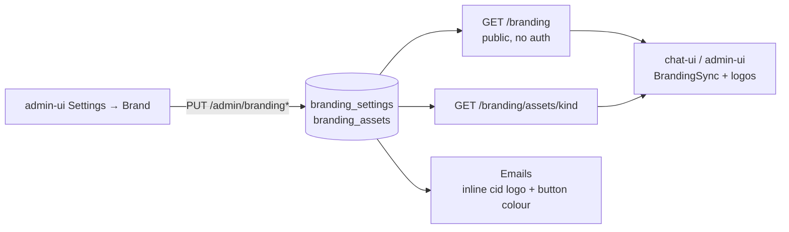

# Tenant branding

An administrator can show the company's own brand in AION from
**admin-ui → Settings → Brand** (`/settings#branding`). Branding is per tenant
(one tenant per deployment, `AION_DEFAULT_TENANT_ID`) and is stored in the
database, so it is part of the regular backups. Nothing is configured through
`.env`.

| Setting | Where it shows | Notes |
|---------|----------------|-------|
| **Logo, light theme** | Login pages, chat sidebar, admin sidebar and mobile top bar, first-setup page, email header | PNG, JPEG, WebP or SVG, up to 1 MB |
| **Logo, dark theme** (optional) | Same places, in the dark theme | Without it the light logo is used in both themes |
| **Favicon** | Browser tab of chat-ui and admin-ui | PNG, ICO or SVG, up to 256 KB |
| **Primary colour, light theme** | Buttons, links, focus rings, highlights; email buttons | `#rrggbb`; empty means the AION red |
| **Primary colour, dark theme** | Same, in the dark theme | Empty falls back to the light colour, then to the AION red |

## "Powered by AION" is mandatory

When a custom logo is active, the text **"Powered by AION"**, linking to
[aion-asa.com](https://aion-asa.com), is shown under every logo and in the
footer of every email. This is a product rule: there is no setting to turn it
off. The string is not translated because it is a brand mark. Without a custom
logo the AION logo is shown and no attribution is needed.

## How it works

### Backend

- Tables `branding_settings` (colours) and `branding_assets` (images as
  bytes, with MIME type, size and SHA-256), migration `b7r8n9d038_branding`.
- `src/branding/service.py` reads and writes them, with a 15 s in-process cache
  that is cleared on every change.
- `src/branding/images.py` validates uploads:
  - the type is detected from the file's **magic bytes**, never from the
    browser's `Content-Type`;
  - SVGs containing scripts, event handlers, `javascript:` URLs, entities or
    embedded documents are refused (`unsafe_svg`).
- Admin endpoints (admin role required, every change is written to the audit
  log as `branding.update`, `branding.asset.put`, `branding.asset.delete`,
  never with image bytes):
  - `GET /admin/branding`
  - `PUT /admin/branding` with `{primary_color_light, primary_color_dark}`
    (`null` = AION default)
  - `PUT /admin/branding/assets/{logo_light|logo_dark|favicon}` (multipart field `file`)
  - `DELETE /admin/branding/assets/{kind}`
- Public endpoints (no auth, because the login pages are branded too):
  - `GET /branding` returns the colours, the asset URLs and `custom_logo`.
  - `GET /branding/assets/{kind}?v=<hash>` serves the image with an ETag. The
    response is cached as immutable only when `v` matches the current file,
    so a new upload changes the URL. It also sends `nosniff` and, for SVG, a
    `sandbox` Content-Security-Policy so that opening the file directly cannot
    run anything.

| Error code | HTTP | Meaning |
|------------|------|---------|
| `invalid_color` | 400 | Not a `#rrggbb` colour |
| `unsafe_svg` | 400 | SVG with active content |
| `invalid_kind` | 404 | Unknown asset kind |
| `too_large` | 413 | Over the size limit (`max_bytes` in the response) |
| `unsupported_type` | 415 | Format not allowed for this kind |
| `empty_file` | 422 | Empty upload |

### Frontends

Both apps have the same small module:

- `lib/branding/branding.ts`: a store fed by `GET /branding`, cached in
  `localStorage` (`aion-branding`).
- `lib/branding/colors.ts`: turns a hex colour into the HSL-channel tokens of
  `styles/theme-tokens.css`. It sets `--primary`, `--ring`, `--sidebar-primary`
  and `--sidebar-ring`, plus `--accent` in the light theme. The foreground
  (white or near-black) is picked by WCAG contrast.
- The same stylesheet also redefines Tailwind's `rose-*` palette
  (`--color-rose-50` … `--color-rose-950`, mixed from the brand colour with
  `color-mix`) and the `brand-end` / `brand-end-hover` tokens, the end of
  the brand gradients (default `red-600` / `red-700`). In chat-ui, `rose-*`
  and `brand-end` are reserved for **brand accents** (gradient buttons, glows,
  highlights). Errors and destructive actions use `destructive` or `red-*`,
  so they stay red with any brand colour.
- `components/brand/BrandingSync.tsx`: mounted in the root layout. It writes
  `<style id="aion-branding">` and adds its own `<link rel="icon">` for the
  tenant favicon. Next.js re-creates its icon links on client navigation, so
  a `MutationObserver` on `<head>` keeps them parked while a favicon is set.
- `lib/branding/init-script.ts`: an inline `<head>` script that applies the
  cached colours before first paint, so a branded tenant never sees the AION
  red flash on reload.
- `ChatBrand` / `AdminBrand`: show the custom logo (light and dark versions
  switch with the theme) with `PoweredByAion` under it. They fall back to the
  AION SVG when no custom logo is set. On a first visit with nothing cached
  they show an empty box of the same size, so no wrong logo flashes.

### Emails

Invite, reset and migration emails (and the SMTP test email):

- **Logo:** the light logo (or the dark one when only that exists) is attached
  as an inline image (`cid:aion-brand-logo`), so no public URL is needed.
  Only PNG and JPEG are embedded, because most mail clients block SVG and
  WebP. With other formats the email keeps the default header, and the admin
  page shows a warning.
- **Button colour:** buttons use the light primary colour, with white or dark
  text chosen by contrast.
- **Attribution:** with any custom logo, the footer shows "Powered by AION"
  (HTML and plain text).

## Tips

- Use a logo with a transparent background and **no empty margins** around
  it: margins are part of the image and make the visible mark smaller.
- The logo is scaled to fit a box, larger than the AION logo's because
  uploaded logos rarely fill their image: up to 300 × 96 px on the login
  pages, the full sidebar width × 48 px in the sidebars, 150 × 36 px in the
  admin mobile top bar. Wide logos fill the width, square ones the height.
  Small images are scaled up, so upload at least twice those sizes (or an
  SVG) to keep the logo sharp.
- Check the contrast warning in the colour fields: a colour too close to the
  page background makes buttons and links hard to see (WCAG 3:1).
- Removing the logo restores the AION logo and removes the attribution. Clicking
  "Restore AION colours" and saving restores the default red.
